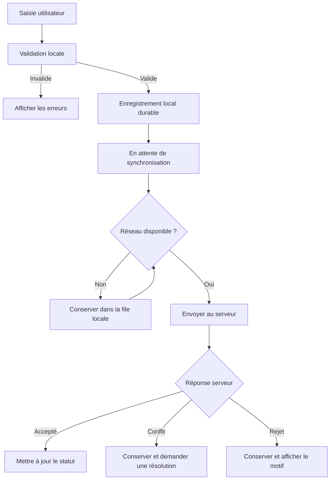

# COOPECA — App Flow et flux applicatifs

**Version :** 1.0  
**Statut :** Document de travail à confronter aux sources officielles  
**Application :** Mobile Android et tableau de bord web

> Les règles indiquées « À valider » ne constituent pas des décisions métier définitives.

## 1. Objectif

Décrire les parcours utilisateurs, la navigation et les flux métier de COOPECA : authentification, clients, dossiers, collectes, reçus, remises de fonds, clôture journalière et synchronisation.

Principes structurants :
- Le mobile doit fonctionner sans connexion et synchroniser les opérations lorsque le réseau est disponible.
- Le serveur reste l'autorité pour l'acceptation définitive des opérations et l'attribution des numéros officiels.
- Les opérations financières doivent être traçables.
- Les données doivent être isolées par agence côté serveur.
- Les montants sont exprimés en XAF et manipulés comme des nombres entiers.

## 2. Acteurs et rôles

| Rôle | Responsabilités générales |
|---|---|
| Agent | Gérer les clients et dossiers autorisés, enregistrer les collectes, déclarer les remises et effectuer sa clôture |
| Superviseur | Superviser l'activité et autoriser les actions exceptionnelles prévues |
| Caissier | Vérifier les fonds remis et confirmer leur réception |
| Comptable / contrôleur | Contrôler les opérations et rapprochements |
| Administrateur | Administrer les comptes, rôles et paramètres autorisés |
| Direction / auditeur | Consulter les rapports et la piste d'audit |

**À valider :** permissions exactes de chaque rôle et séparation des tâches.

## 3. Navigation mobile

Écrans prévus dans le squelette :
- Connexion
- Accueil
- Clients
- Collectes
- Remises
- Clôture journalière
- Consultation d'un reçu

Routes repérées :
- `mobile/app/(auth)/login.tsx`
- `mobile/app/(tabs)/index.tsx`
- `mobile/app/(tabs)/clients.tsx`
- `mobile/app/(tabs)/collectes.tsx`
- `mobile/app/(tabs)/remises.tsx`
- `mobile/app/(tabs)/cloture.tsx`
- `mobile/app/recus/[id].tsx`

La présence de ces fichiers ne signifie pas que les fonctions sont déjà implémentées.

## 4. Authentification

1. L'utilisateur ouvre l'application.
2. Il saisit ses identifiants.
3. Le serveur valide l'authentification lorsqu'une connexion est disponible.
4. L'application ouvre les fonctions autorisées pour le rôle et l'agence.
5. Les données de session sont conservées selon la politique de sécurité retenue.

**À valider :** durée de session, accès hors ligne après une première authentification, révocation de session et récupération du compte.

## 5. Parcours clients

1. L'agent consulte la liste des clients.
2. Il recherche un client ou commence une création.
3. L'application vérifie localement les champs requis.
4. Hors ligne, un nouveau client peut être enregistré avec un identifiant stable et un statut provisoire.
5. L'opération attend la synchronisation.
6. Le serveur valide l'opération et renvoie son résultat.
7. En cas de conflit ou de rejet, l'application affiche une explication et conserve les informations nécessaires à la résolution.

**À valider :** champs obligatoires, détection des doublons et procédure de rapprochement.

## 6. Parcours dossiers

Décisions métier déjà consignées :
- Un dossier peut être créé hors ligne avec un identifiant stable.
- Le dossier reste en attente d'acceptation du serveur.
- Un seul dossier ouvert est autorisé par client et par agence.
- Des dossiers successifs sont possibles.
- Les dossiers de différentes agences sont indépendants.
- Un dossier fermé bloque les nouvelles collectes qui lui sont associées.
- L'historique est conservé ; aucune suppression silencieuse.
- Chaque collecte doit être liée à un dossier précis.
- Les collectes historiques ne doivent pas être affectées arbitrairement à un dossier.

### Flux proposé

1. L'agent sélectionne un client.
2. L'application affiche son dossier ouvert ou permet de demander la création d'un dossier.
3. Si la création est hors ligne, un identifiant stable est attribué localement.
4. À la synchronisation, le serveur vérifie les règles métier et l'unicité.
5. Si une création concurrente est détectée, l'application présente un conflit explicite.

**Décisions à valider :**
- résolution des créations concurrentes ;
- autorité de clôture hors ligne ;
- motif et autorisation de réouverture ;
- traitement des collectes enregistrées avant clôture mais synchronisées après ;
- champs obligatoires et numérotation des dossiers ;
- rapprochement des collectes historiques.

## 7. Parcours de collecte

1. L'agent sélectionne un client et un dossier précis.
2. L'application vérifie l'état connu du dossier.
3. L'agent saisit le montant en XAF et les champs requis.
4. L'application valide la saisie.
5. La collecte est enregistrée localement de manière durable.
6. Une référence provisoire permet de retrouver l'opération avant acceptation serveur.
7. À la synchronisation, le serveur accepte l'opération ou retourne un conflit ou un rejet explicite.
8. L'application conserve la date métier déclarée et distingue celle-ci de l'heure de réception serveur.

Règles :
- Utiliser des entiers XAF pour les calculs financiers.
- Rendre les requêtes idempotentes.
- Une même clé d'idempotence associée à des contenus différents doit provoquer un conflit explicite.
- Une collecte ne peut pas être fractionnée entre plusieurs remises.
- Les corrections et annulations doivent être autorisées et auditées.

**À valider :** champs requis, seuils d'horloge incorrecte, procédure de correction et règles d'annulation.

## 8. Reçus

- Une référence locale stable permet de retrouver un reçu provisoire.
- Le serveur attribue le numéro officiel à l'acceptation de l'opération.
- Après synchronisation, la référence provisoire et le numéro officiel peuvent être affichés ensemble.
- Les copies et réimpressions doivent conserver la traçabilité.
- Un reçu imprimé ne doit pas être invalidé silencieusement.

**À valider :** format légal, mentions obligatoires, format d'impression, numérotation et comportement en cas de rejet après impression.

## 9. Remises de fonds

La déclaration de remise de l'agent est distincte de la confirmation de réception par le caissier.

1. L'agent sélectionne les collectes non encore remises.
2. L'application affiche les collectes sélectionnées et leur total.
3. La remise contient des collectes entières.
4. L'agent enregistre sa déclaration, éventuellement hors ligne.
5. La déclaration est synchronisée.
6. Le caissier vérifie les fonds reçus.
7. Le caissier confirme la réception ou signale un écart.
8. Les écarts sont documentés et traités selon les droits autorisés.

**À valider :** annulation, modification, pièces justificatives et workflow de résolution des écarts.

## 10. Clôture journalière

- Chaque agent peut enregistrer sa clôture hors ligne ; elle attend alors la synchronisation.
- Le fuseau métier est `Africa/Ndjamena`.
- La journée métier va de minuit à minuit.
- La date métier d'une collecte et l'instant de réception serveur sont deux informations distinctes.
- Une réouverture doit être réservée aux rôles autorisés, justifiée et auditée.

**À valider :** calculs de clôture, données incluses, traitement des opérations en attente et procédure de réouverture.

## 11. Synchronisation hors ligne

Principes :
- File locale durable.
- Identifiants stables et clés d'idempotence.
- Séparation des états métier et des états de synchronisation.
- Conservation des opérations en conflit ou rejetées jusqu'à résolution explicite.
- Aucun effacement automatique après un rejet.
- Attribution des numéros officiels par le serveur.

**À valider techniquement :** chiffrement de la base locale, reprise, taille des lots, ordre des dépendances et gestion des changements de compte.

## 12. Tableau de bord web

Fonctions envisagées :
- consultation des clients et dossiers ;
- suivi des collectes et reçus ;
- suivi des déclarations de remise et confirmations de caisse ;
- suivi des clôtures journalières ;
- suivi des conflits et rejets de synchronisation ;
- rapports et piste d'audit.

Cette liste reste à confronter au parcours web fonctionnel de référence. Les droits d'accès doivent être contrôlés côté serveur.

## 13. États et erreurs

L'interface doit distinguer :
- saisie en cours ;
- enregistrée localement ;
- en attente de synchronisation ;
- acceptée par le serveur ;
- conflit à résoudre ;
- rejetée avec motif ;
- impression réussie ou échouée ;
- opération corrigée ou annulée selon un processus autorisé.

Une opération enregistrée localement ne doit pas être présentée comme définitivement acceptée par le serveur.

Ce document ne remplace pas les sources originales. Les points « À valider » doivent faire l'objet d'une décision explicite.
